# Secret Store

API RESTful para gerenciamento seguro de segredos (credenciais), com criptografia AES-256-CBC, construida com NestJS 11, MikroORM 7 e PostgreSQL 18. Inclui tambem uma interface CLI (linha de comando) independente.

Desenvolvido inteiramente com **vibe coding** utilizando [Claude Code](https://claude.ai/code) como projeto da **Especializacao em Inteligencia Artificial - UFG**.

---

## Sobre o Projeto e Vibe Coding

Este projeto foi desenvolvido completamente utilizando a tecnica de **vibe coding** com o [Claude Code](https://claude.ai/code), o assistente de IA da Anthropic para desenvolvimento de software. Vibe coding e uma abordagem onde o desenvolvedor descreve a intencao e o comportamento desejado em linguagem natural, e a IA gera, refatora e mantem o codigo-fonte.

O proposito deste projeto e demonstrar, na pratica, como ferramentas de IA generativa podem ser utilizadas no ciclo completo de desenvolvimento de software — desde a arquitetura e modelagem ate a implementacao, testes e documentacao — dentro do contexto da **Especializacao em Inteligencia Artificial da Universidade Federal de Goias (UFG)**.

### O que o Claude Code fez

- Arquitetou toda a estrutura do projeto seguindo principios SOLID
- Implementou todos os endpoints REST e comandos CLI
- Criou a camada de criptografia com AES-256-CBC
- Escreveu testes unitarios para controllers e services
- Configurou MikroORM, Swagger, validacao de environment variables
- Refatorou o codigo multiplas vezes para seguir a convencao de um-metodo-por-classe

## Visão arquitetural documentada com GenAI

### Escopo e nível da visão

O Secret Store é um serviço de gerenciamento de credenciais que expõe uma API REST e uma CLI independente. Esta documentação usa duas visões complementares: uma visão de containers em nível de sistema/runtime, para mostrar os pontos de entrada, o núcleo de casos de uso, a proteção criptográfica e o PostgreSQL; e uma visão comportamental da jornada `POST /api/secrets`, para mostrar a ordem das chamadas.

O sistema suporta criar, listar, consultar, atualizar e remover segredos, além de gerar senhas. O mesmo núcleo de serviços é reutilizado pela API e pelos comandos CLI por meio de tokens de interfaces. As respostas HTTP são validadas, envelopadas pelo `TransformInterceptor` e tratadas pelo `HttpExceptionFilter` em caso de erro.

### Limites e responsabilidades

- **Entradas:** `src/main.ts` inicializa a API HTTP; `src/cli/main.ts` inicializa a CLI com `nest-commander`.
- **Aplicação:** controllers HTTP e commands CLI adaptam entradas; os services em `src/secrets/` executam os casos de uso.
- **Proteção:** `EncryptionService` cifra e decifra senhas com AES-256-CBC e IV aleatório. A chave é fornecida por `ENCRYPTION_KEY` e precisa ter exatamente 32 caracteres.
- **Persistência:** MikroORM e `SecretRepository` persistem a entidade `Secret` no PostgreSQL. O valor armazenado é `iv:ciphertext`; a senha em texto plano não é persistida.
- **Operação local:** `docker-compose.yaml` sobe PostgreSQL 18 e o serviço, conectados pela rede `secret-store-network`; o container executa `schema:update` antes da API.

### Integrações, restrições e lacunas

As integrações observadas no código são PostgreSQL via MikroORM, Docker Compose para execução local/contêiner, Swagger opcional em `/api/docs` e o terminal para a CLI. Não foram identificados provedor de identidade, filas, serviços externos ou armazenamento de objetos.

As principais restrições são a dependência de `ENCRYPTION_KEY`, a disponibilidade do PostgreSQL e o uso de AES-256-CBC sem mecanismo de autenticação de ciphertext visível no código. Também não há, nesta implementação, autenticação/autorização HTTP, rotação de chaves, auditoria de acesso, política de backup/restore, rate limiting ou mascaramento explícito da senha retornada. Esses pontos são lacunas de segurança/operabilidade a tratar antes de uma exposição pública.

### Diagrama estrutural — containers/runtime

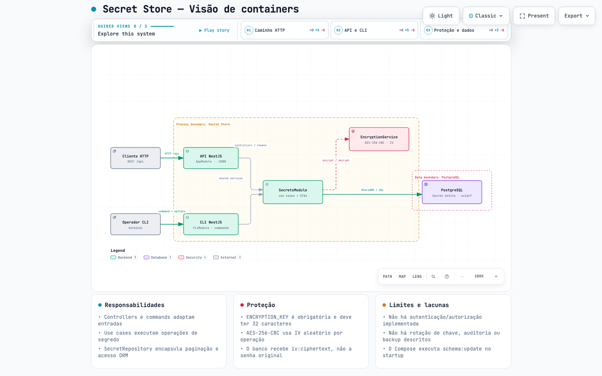

[Abrir o diagrama estrutural interativo](docs/diagrams/secret-store.architecture.html) · [Especificação Archify](docs/diagrams/secret-store.architecture.json)

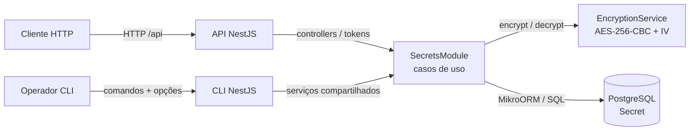

### Diagrama comportamental — criar segredo

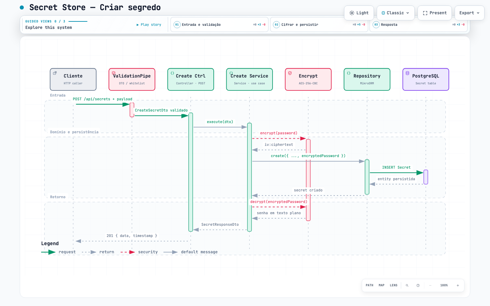

[Abrir o diagrama de sequência interativo](docs/diagrams/create-secret.sequence.html) · [Especificação Archify](docs/diagrams/create-secret.sequence.json)

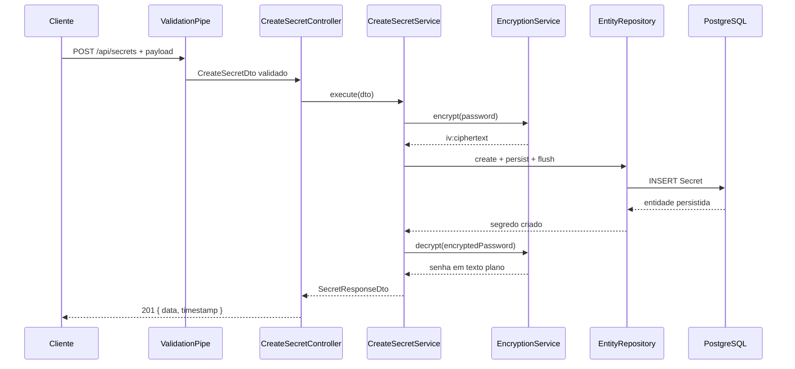

### Decisões e ajustes sobre a geração

Os diagramas foram gerados a partir da leitura do código e das descrições existentes neste README, usando Mermaid como representação semântica e Archify para produzir os artefatos renderizados. As decisões principais foram:

1. Mostrar API e CLI como entradas separadas, porque possuem bootstraps (`NestFactory` e `CommandFactory`) distintos, mas compartilham `SecretsModule`, `SharedModule` e os tokens de serviço.
2. Escolher `POST /api/secrets` como jornada crítica, pois ela evidencia validação, injeção por interface, cifragem, persistência e montagem da resposta.
3. Omitir dependências não comprovadas no repositório, como autenticação, fila ou serviços cloud.
4. Remover `sources` dos JSON do Archify porque o projeto local não possui URL/revisão Git pública compatível com o contrato do renderer; as evidências permanecem registradas pelos caminhos de código nesta seção.
5. Encurtar alguns rótulos visuais do sequence diagram (`Create Ctrl`, `Encrypt`, `Repository`) para respeitar a largura mínima legível; os identificadores completos continuam no Mermaid e no texto descritivo.
6. Compactar o eixo temporal e remover cards redundantes do artefato comportamental para manter o diagrama inteiro contido em telas desktop, sem retirar mensagens da jornada.

Os receipts automatizados ficam em [`docs/diagrams/secret-store.architecture.visual-check.json`](docs/diagrams/secret-store.architecture.visual-check.json) e [`docs/diagrams/create-secret.sequence.visual-check.json`](docs/diagrams/create-secret.sequence.visual-check.json). A revisão perceptual final ainda depende de um leitor humano; os checks de navegador confirmam containment, legibilidade mínima, chrome do viewer e ausência de overflow nos tamanhos testados.

---

## Stack Tecnologica

| Tecnologia | Versao   | Uso |
|---|----------|---|
| **Node.js** | ^24      | Runtime |
| **TypeScript** | ^5.7.3   | Linguagem |
| **NestJS** | ^11.0.1  | Framework |
| **MikroORM** | ^7.0.11  | ORM |
| **PostgreSQL** | 18       | Banco de dados |
| **Swagger/OpenAPI** | ^11.3.2  | Documentacao da API |
| **nest-commander** | ^3.20.1  | Interface CLI |
| **SWC** | ^1.15.30 | Compilador (transpilacao Rust) |
| **class-validator** | ^0.15.1  | Validacao de DTOs |
| **class-transformer** | ^0.5.1   | Transformacao de DTOs |
| **Jest** | ^30.0.0  | Testes |
| **ESLint** | ^9.18.0  | Linting |
| **Prettier** | ^3.4.2   | Formatacao |
| **pnpm** | -        | Gerenciador de pacotes |

---

## Arquitetura

O projeto segue uma arquitetura em camadas com separacao estrita de responsabilidades. Cada feature e isolada em seu proprio sub-modulo, e cada classe possui **uma unica responsabilidade** (um metodo publico por service, um endpoint por controller).

### Estrutura de Diretorios

```
secret-store/
  src/
    main.ts                          # Entry point HTTP: NestFactory.create(AppModule)
    app.module.ts                    # Modulo raiz: ConfigModule, DatabaseModule, SharedModule, SecretsModule
    app.controller.ts                # Health check (GET /api/health)
    app.service.ts                   # Logica do health check
    config/
      configuration.ts               # Factory de configuracao tipada (node, database, encryption, swagger)
      env.validation.ts              # Schema Joi para validacao de env vars
      config.module.ts               # ConfigModule.forRoot (global)
    database/
      database.module.ts             # MikroORM forRootAsync com ConfigService
    shared/
      shared.module.ts               # Modulo @Global para providers transversais
      logger/
        logger.service.ts            # ConsoleLogger customizado (scope TRANSIENT)
        logger.module.ts
      filters/
        http-exception.filter.ts     # Filtro global de excecoes HTTP
      interceptors/
        transform.interceptor.ts     # Interceptor global de resposta ({ data, timestamp })
      dto/
        pagination.dto.ts            # DTO reutilizavel de paginacao (page, limit)
        api-response.dto.ts          # DTO generico de resposta da API
      encryption/
        encryption.service.ts        # Criptografia AES-256-CBC
        encryption.module.ts
    cli/
      main.ts                        # Entry point CLI: CommandFactory.run(CliModule)
      cli.module.ts                  # Importa CliConfigModule, SharedModule, modulos de comandos
      config/
        cli-config.module.ts         # ConfigModule para contexto CLI
        cli-env.validation.ts        # Schema Joi para env vars do CLI (ENCRYPTION_KEY opcional)
      commands/
        generate-password/           # Comando auto-contido: command, module, dto, spec
        create-secret/
        get-secret/
        list-secrets/
        update-secret/
        delete-secret/
      utils/
        output.util.ts               # Utilitarios de formatacao de saida CLI
    secrets/
      secrets.module.ts              # Importa todos os sub-modulos de secrets
      entities/
        secret.entity.ts             # Entidade Secret (defineEntity, PK uuidv7)
      repositories/
        secret.repository.ts         # Repository customizado com findPaginated()
      domain/                        # Interfaces de servico com tokens Symbol para DI
        create-secret.service.interface.ts
        delete-secret.service.interface.ts
        generate-password.service.interface.ts
        get-secret.service.interface.ts
        list-secrets.service.interface.ts
        update-secret.service.interface.ts
      dto/
        create-secret.dto.ts
        update-secret.dto.ts
        secret-response.dto.ts
        generate-password.dto.ts
        generate-password-response.dto.ts
      create-secret/                 # Sub-modulo: module, controller, service, specs
      delete-secret/
      generate-password/
      get-secret/
      list-secrets/
      update-secret/
  test/
    app.e2e-spec.ts                  # Testes end-to-end
    secrets.e2e-spec.ts              # Testes e2e da feature de secrets
    jest-e2e.json                    # Configuracao Jest para e2e
  Dockerfile                         # Multi-stage build otimizado (Node 24, non-root user)
  docker-compose.yaml                # PostgreSQL 18 + Secret Store
  docs/
    http/                            # Requisicoes HTTP para IntelliJ HTTP Client / VS Code REST Client
```

### Arquitetura Dual (HTTP API + CLI)

O projeto opera como duas aplicacoes NestJS independentes compartilhando a mesma base de codigo:

| | API HTTP | CLI |
|---|---|---|
| **Entry point** | `src/main.ts` | `src/cli/main.ts` |
| **Modulo raiz** | `AppModule` | `CliModule` |
| **Bootstrap** | `NestFactory.create()` | `CommandFactory.run()` |
| **Validacao de env** | `env.validation.ts` (ENCRYPTION_KEY obrigatoria) | `cli-env.validation.ts` (ENCRYPTION_KEY opcional) |
| **Codigo compartilhado** | `SharedModule`, `SecretsModule` | `SharedModule`, interfaces via `domain/` |

### Padrao de Injecao de Dependencia

Servicos sao injetados via **tokens Symbol e interfaces**, nao classes concretas. Isso desacopla os comandos CLI das implementacoes especificas:

```typescript
// domain/get-secret.service.interface.ts
export const GET_SECRET_SERVICE = Symbol('GET_SECRET_SERVICE');
export interface IGetSecretService {
  execute(id: string): Promise<SecretResponseDto>;
}

// No modulo, bind do token:
{ provide: GET_SECRET_SERVICE, useClass: GetSecretService }
```

### Criptografia

As senhas sao criptografadas com **AES-256-CBC** antes de serem armazenadas no banco de dados. O `EncryptionService` utiliza uma chave de 32 caracteres definida pela env var `ENCRYPTION_KEY`. Cada operacao de criptografia gera um IV (Initialization Vector) aleatorio, que e armazenado junto ao ciphertext no formato `iv:encrypted_data`.

---

## Endpoints da API

Todos os endpoints estao sob o prefixo `/api`.

### Health Check

| Metodo | Rota | Descricao | Status |
|---|---|---|---|
| `GET` | `/api/health` | Verifica saude do servico | `200` |

### Secrets

| Metodo | Rota | Descricao | Status |
|---|---|---|---|
| `POST` | `/api/secrets` | Cria um novo segredo | `201` |
| `GET` | `/api/secrets` | Lista segredos com paginacao | `200` |
| `GET` | `/api/secrets/:id` | Busca um segredo por ID | `200` |
| `PUT` | `/api/secrets/:id` | Atualiza um segredo | `200` |
| `DELETE` | `/api/secrets/:id` | Remove um segredo | `204` |
| `PATCH` | `/api/secrets/generate-password` | Gera uma senha aleatoria | `200` |

### Formato de Resposta

Todas as respostas (exceto `204 No Content`) seguem o formato padrao envelopado pelo `TransformInterceptor`:

```json
{
  "data": { ... },
  "timestamp": "2026-04-26T12:00:00.000Z"
}
```

Erros seguem o formato do `HttpExceptionFilter`:

```json
{
  "statusCode": 404,
  "message": "Secret not found",
  "timestamp": "2026-04-26T12:00:00.000Z"
}
```

---

## Fluxo dos Endpoints (Mermaid)

### Fluxo Geral de Requisicao

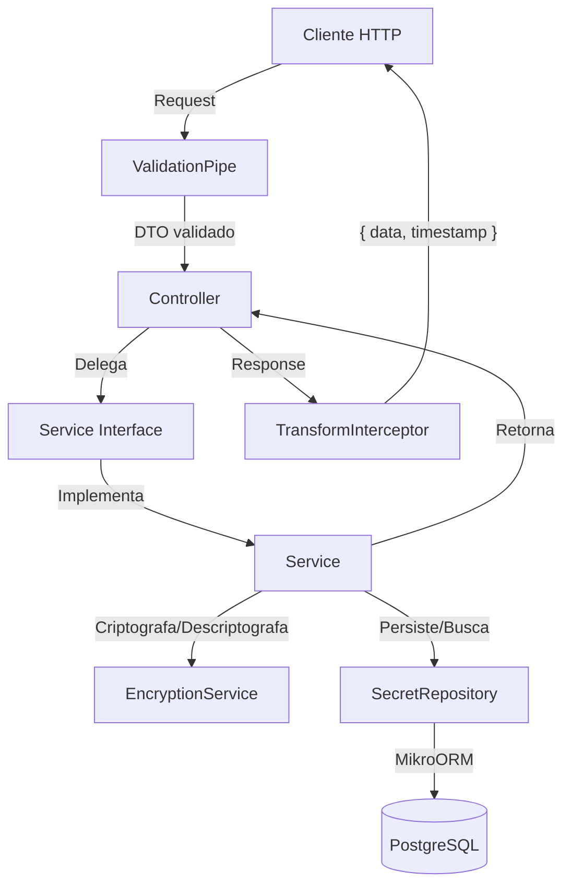

### Criar Segredo (`POST /api/secrets`)

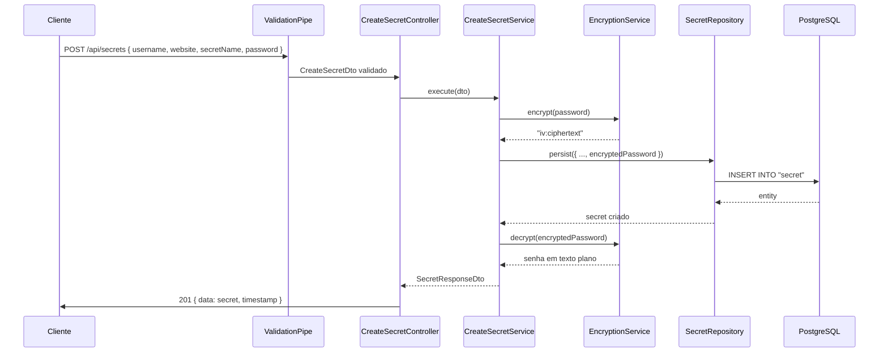

### Listar Segredos (`GET /api/secrets`)

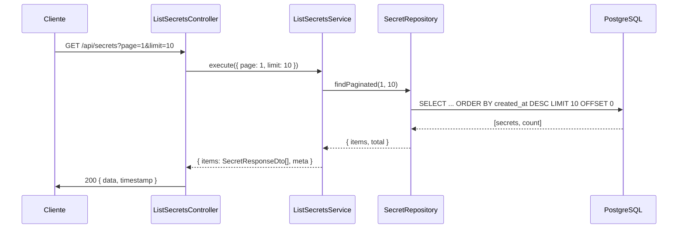

### Buscar Segredo por ID (`GET /api/secrets/:id`)

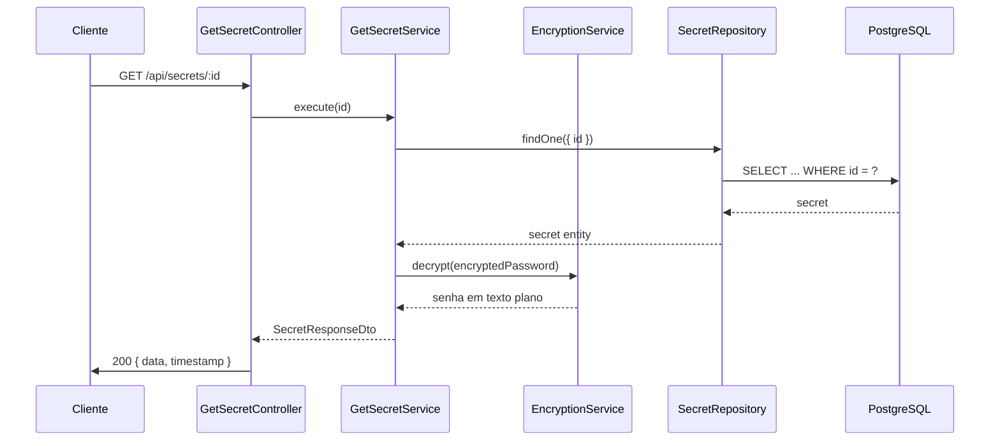

### Atualizar Segredo (`PUT /api/secrets/:id`)

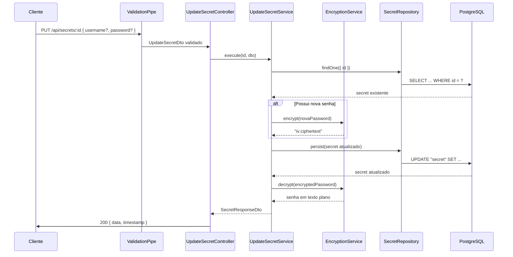

### Remover Segredo (`DELETE /api/secrets/:id`)

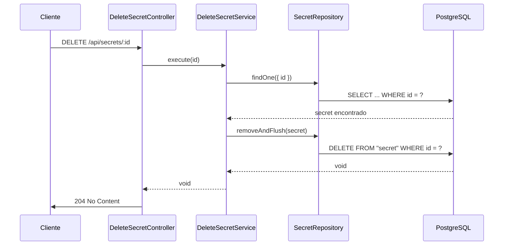

### Gerar Senha (`PATCH /api/secrets/generate-password`)

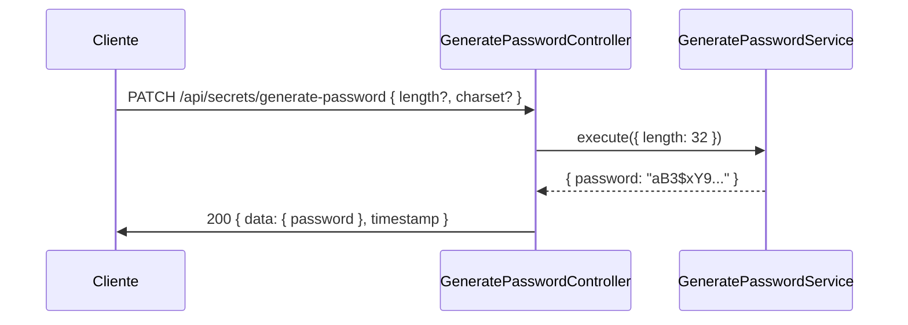

---

## Comandos CLI

A aplicacao tambem possui uma interface CLI independente, construida com `nest-commander`.

| Comando | Descricao | Opcoes |
|---|---|---|
| `generate-password` | Gera uma senha aleatoria | `-l, --length <n>` |
| `create-secret` | Cria um novo segredo | username, website, secretName, password |
| `get-secret` | Busca um segredo por ID | id |
| `list-secrets` | Lista segredos com paginacao | page, limit |
| `update-secret` | Atualiza um segredo existente | id, campos opcionais |
| `delete-secret` | Remove um segredo | id |

---

## Como Executar

### Pre-requisitos

- **Node.js** >= 24
- **pnpm** (instalar com `npm install -g pnpm`)
- **Docker** e **Docker Compose** (para o banco de dados)

### 1. Clonar o repositorio

```bash
git clone <url-do-repositorio>
cd secret-store
```

### 2. Instalar dependencias

```bash
pnpm install
```

### 3. Configurar variaveis de ambiente

Copie o arquivo de exemplo e ajuste os valores:

```bash
cp .env.example .env
```

Variaveis disponiveis:

| Variavel | Obrigatoria | Padrao | Descricao |
|---|---|---|---|
| `NODE_ENV` | Nao | `development` | Ambiente (`development`, `production`, `test`) |
| `PORT` | Nao | `3000` | Porta do servidor HTTP |
| `DB_HOST` | Nao | `localhost` | Host do PostgreSQL |
| `DB_PORT` | Nao | `5432` | Porta do PostgreSQL |
| `DB_NAME` | Nao | `secret_store` | Nome do banco de dados |
| `DB_USER` | Nao | `secret_store_user` | Usuario do banco |
| `DB_PASSWORD` | Nao | `secret_store_password` | Senha do banco |
| `ENCRYPTION_KEY` | **Sim** | - | Chave de criptografia (exatamente 32 caracteres) |
| `SWAGGER_ENABLED` | Nao | `true` | Habilita Swagger UI (`true` / `false`) |

### 4. Subir o banco de dados (desenvolvimento local)

```bash
# Iniciar PostgreSQL
docker compose up -d postgres

# Verificar se esta rodando
docker compose logs -f postgres

# Parar o banco
docker compose down
```

### 5. Criar o schema do banco (desenvolvimento local)

```bash
# Criar schema pela primeira vez
pnpm run schema:create

# Atualizar schema (desenvolvimento)
pnpm run schema:update

# Recriar schema do zero (desenvolvimento)
pnpm run schema:fresh
```

### 6. Executar a aplicacao (desenvolvimento local)

```bash
# Desenvolvimento (hot-reload)
pnpm run start:dev

# Desenvolvimento com debug
pnpm run start:debug

# Producao
pnpm run build
pnpm run start:prod
```

### 7. Executar o CLI (desenvolvimento local)

```bash
# Desenvolvimento
pnpm run cli:dev -- --help
pnpm run cli:dev -- generate-password --length 32
pnpm run cli:dev -- create-secret

# Producao (necessita build previo)
pnpm run cli -- --help
pnpm run cli -- generate-password --length 32
pnpm run cli -- create-secret
```

---

## Docker (Producao)

A aplicacao pode ser executada inteiramente via Docker Compose. O container inclui a API HTTP e o CLI, e executa automaticamente a migracao do schema do banco ao iniciar.

### Variaveis de ambiente

A unica variavel obrigatoria e `ENCRYPTION_KEY` (exatamente 32 caracteres). Todas as demais possuem valores padrao.

| Variavel | Obrigatoria | Padrao | Descricao |
|---|---|---|---|
| `ENCRYPTION_KEY` | **Sim** | - | Chave de criptografia (exatamente 32 caracteres) |
| `NODE_ENV` | Nao | `production` | Ambiente |
| `PORT` | Nao | `3000` | Porta do servidor HTTP (host) |
| `DB_USER` | Nao | `secret_store_user` | Usuario do banco |
| `DB_PASSWORD` | Nao | `secret_store_password` | Senha do banco |
| `DB_NAME` | Nao | `secret_store` | Nome do banco |
| `SWAGGER_ENABLED` | Nao | `true` | Habilita Swagger UI |

### Subir a aplicacao

```bash
# Iniciar todos os servicos (PostgreSQL + API)
ENCRYPTION_KEY="your-32-character-key-here!!!!!!!!!!" docker compose up -d

# Ver logs
docker compose logs -f secret-store

# Parar tudo
docker compose down
```

A API estara disponivel em `http://localhost:3000/api` e o Swagger em `http://localhost:3000/api/docs`.

### Executar comandos CLI no container

```bash
# Gerar uma senha
docker compose exec secret-store node dist/cli/main.js generate-password --length 32

# Criar um segredo
docker compose exec secret-store node dist/cli/main.js create-secret

# Listar segredos
docker compose exec secret-store node dist/cli/main.js list-secrets

# Ver ajuda
docker compose exec secret-store node dist/cli/main.js --help
```

### Reconstruir a imagem

```bash
docker compose build --no-cache secret-store
```

---

## Testes

```bash
# Testes unitarios
pnpm run test

# Teste especifico
pnpm run test -- --testPathPattern=create-secret.service

# Testes em modo watch
pnpm run test:watch

# Cobertura de testes
pnpm run test:cov

# Testes end-to-end
pnpm run test:e2e
```

---

## Linting e Formatacao

```bash
# Lint com auto-fix
pnpm run lint

# Formatar codigo
pnpm run format
```

---

## Documentacao da API (Swagger)

Com a aplicacao rodando e `SWAGGER_ENABLED=true`, acesse:

```
http://localhost:3000/api/docs
```

---

## Requisicoes HTTP (Docs)

O diretorio `docs/http/` contem arquivos `.http` compativel com **IntelliJ HTTP Client** e **VS Code REST Client**. Eles incluem variaveis de ambiente e scripts para encadear requisicoes (por exemplo, o ID retornado ao criar um segredo e automaticamente reutilizado nas requisicoes de busca, atualizacao e remocao).

```
docs/
  http/
    http-client.env.json          # Variaveis de ambiente (baseUrl)
    health.http                   # GET /api/health
    secrets/
      create-secret.http          # POST /api/secrets
      get-secret.http             # GET /api/secrets/:id
      list-secrets.http           # GET /api/secrets
      update-secret.http          # PUT /api/secrets/:id
      delete-secret.http          # DELETE /api/secrets/:id
      generate-password.http      # PATCH /api/secrets/generate-password
```

Para usar, abra os arquivos no IntelliJ IDEA ou instale a extensao **REST Client** no VS Code e execute as requisicoes diretamente.

---

## Licenca

[MIT](./LICENSE)

---

## Autor

**Daniel Moreira Cardoso** — Especializacao em Inteligencia Artificial - UFG
