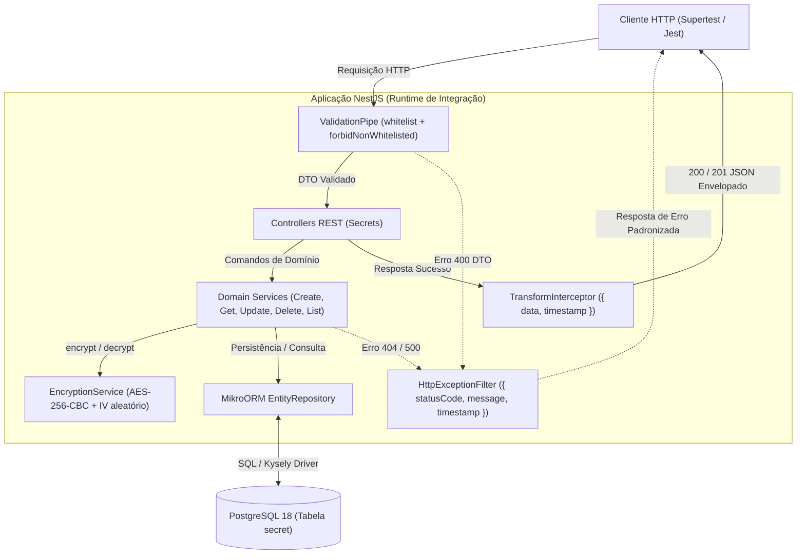

# Unidade III: Testes de Integração Apoiados por GenAI

**Especialização em Inteligência Artificial — Universidade Federal de Goiás (UFG)**  
**Projeto:** [Secret Store](https://github.com/dmcardoso/secret-store)  
**Autor:** Diego Moreira Cardoso  
**Repositório GitHub:** [https://github.com/dmcardoso/secret-store](https://github.com/dmcardoso/secret-store)

---

## 1. Contexto e Cenário de Integração Escolhido

O **Secret Store** é uma API RESTful corporativa desenvolvida em NestJS 11 com MikroORM 7 e PostgreSQL 18, responsável pelo armazenamento e gerenciamento seguro de credenciais com criptografia simétrica **AES-256-CBC**.

Para a atividade da Unidade III, o cenário de integração avaliado compreende a comunicação vertical entre múltiplos módulos e serviços:



### Pontos Críticos de Integração
1. **Fronteira HTTP e Contrato de Dados:** Validação estrita de entrada via `ValidationPipe` descartando campos não mapeados (`forbidNonWhitelisted: true`) e padronização de saídas de erro pelo `HttpExceptionFilter`.
2. **Cifragem Transversal e Invariante de Banco:** A senha recebida em texto plano via API deve ser cifrada pelo `EncryptionService` antes de ser persistida no PostgreSQL na coluna `encrypted_password` no formato `iv:ciphertext`. O banco de dados **nunca** deve armazenar a credencial em claro.
3. **Decifragem Transparente na Recuperação:** Ao consultar um segredo via `GET /api/secrets/:id` ou na listagem paginada `GET /api/secrets`, a integração entre o repositório e o serviço criptográfico deve recompor a credencial em texto plano para o cliente autorizado.
4. **Ciclo de Vida e Consistência:** A mutação de um segredo (`PUT`) deve renovar o vetor de inicialização (IV) e o ciphertext no banco, enquanto a exclusão (`DELETE`) deve expurgar fisicamente o registro do banco, refletindo em `404 Not Found` em requisições subsequentes.

---

## 2. Definição e Estrutura dos Prompts de Teste de Integração

Foram desenvolvidos e avaliados **dois tipos complementares de prompt**:

### Tipo 1: Prompt Orientado a Contrato e Casos Negativos de Fronteira (Negative & API Contract Prompting)
* **Objetivo:** Forçar a geração de casos de teste de integração focados em fronteira de API, conformidade com os DTOs (`CreateSecretDto` e `UpdateSecretDto`), rejeição de propriedades não permitidas e garantia de respostas de erro padronizadas.
* **Técnica:** *Role-Based Specification Prompting* com restrições explícitas de validação e formato de asserção.

#### Versão Inicial (V1)
> *"Crie testes de integração em Jest para a API de segredos do NestJS testando casos de erro e validação do CreateSecretDto."*

* **Resultado da V1:** A LLM gerou testes genéricos de Express, sem configurar o `ValidationPipe` do NestJS e sem validar o envelope de erro customizado do `HttpExceptionFilter`. Os testes falhavam porque a aplicação aceitava qualquer campo sem rejeitar.

#### Versão Refinada (V2 - Utilizada)
```text
Atue como Especialista Sênior em QA e Engenharia de Testes de Software.
Escreva uma suite de testes de integração E2E em TypeScript usando Jest e Supertest para uma API NestJS 11.

Contexto da Aplicação:
- DTO de Criação (CreateSecretDto): username (string, obrigatório), website (string, obrigatório), secretName (string, obrigatório), password (string, obrigatório).
- DTO de Atualização (UpdateSecretDto): campos opcionais (username, website, secretName, password).
- Global Pipes ativos: ValidationPipe({ whitelist: true, forbidNonWhitelisted: true, transform: true }).
- Global Exception Filter: HttpExceptionFilter que retorna { statusCode, message, timestamp }.
- Global Interceptor: TransformInterceptor que retorna { data, timestamp }.
- Prefixo global de rota: 'api'.

Requisitos da Suite de Testes Negativos / Contrato:
1. Rejeição de payload totalmente vazio (HTTP 400 com array de campos obrigatórios faltantes).
2. Rejeição de propriedades não mapeadas no DTO (ex: { isAdmin: true, role: 'superuser' }) garantindo que forbidNonWhitelisted dispare 400.
3. Rejeição de tipos incorretos (números e booleanos em vez de strings).
4. Rejeição de strings vazias nos campos obrigatórios.
5. Tentativa de atualização (PUT) com campos não permitidos e para id inexistente (HTTP 404).
6. Consulta (GET) e deleção (DELETE) de segredos com UUID inexistente, validando a estrutura do erro 404.

Forneça o arquivo completo executável compatível com Test.createTestingModule({ imports: [AppModule] }), sobrescrevendo LoggerService para silenciar logs e inicializando todos os pipes, filtros e interceptores globais.
```

* **Arquivo gerado:** [`test/secrets-contract-integration.e2e-spec.ts`](../test/secrets-contract-integration.e2e-spec.ts) (8 testes, 100% passando).

---

### Tipo 2: Prompt Orientado a Fluxo Transversal e Invariantes de Estado (Cross-Component State & Invariant Prompting)
* **Objetivo:** Validar a integração ponta a ponta entre HTTP -> Service -> EncryptionService (AES-256-CBC) -> MikroORM -> PostgreSQL, testando o ciclo de vida completo e verificando diretamente no banco de dados se os invariantes de criptografia e persistência foram cumpridos.
* **Técnica:** *Chain-of-Thought Architectural State Verification*.

#### Versão Inicial (V1)
> *"Crie um teste de integração E2E que faça um CRUD de segredos na API e veja se cria, busca, atualiza e deleta."*

* **Resultado da V1:** A LLM produziu um teste superficial ("caixa preta tradicional") que apenas fazia chamadas HTTP sucessivas. Esse teste não comprovava a integração real com a cifra, pois um mock ingênuo ou um banco salvando em texto puro passariam despercebidos.

#### Versão Refinada (V2 - Utilizada)
```text
Atue como Engenheiro de Software Especialista em Arquitetura Segura e Testes de Integração.
Desenvolva uma suite de testes de integração E2E em NestJS + MikroORM + PostgreSQL + Supertest que valide fluxos transversais de componentes e invariantes de segurança.

Arquitetura e Componentes Integrados:
- Controller HTTP REST (/api/secrets)
- Domain Services (CreateSecretService, GetSecretService, UpdateSecretService, DeleteSecretService, ListSecretsService)
- EncryptionService (AES-256-CBC com chave de 32 bytes e IV aleatório de 16 bytes; formato gerado: ivHex:ciphertextHex)
- MikroORM EntityRepository e banco relacional PostgreSQL real

Cenários de Integração Obrigatórios:
1. Jornada Completa de Ciclo de Vida:
   a) POST /api/secrets com credencial válida (verifica status 201 e retorno com senha plana para o usuário).
   b) Invariante de Banco de Dados: use EntityManager do MikroORM diretamente para consultar a tabela no PostgreSQL. Valide que o campo encryptedPassword no banco bate a regex /^[0-9a-f]{32}:[0-9a-f]+$/i e NUNCA contém a senha em texto plano.
   c) GET /api/secrets/:id: comprove que a decifragem transparente funciona de ponta a ponta entregando a senha original.
   d) PUT /api/secrets/:id com nova senha: valide no PostgreSQL que um novo ciphertext com novo IV foi gerado e updatedAt foi renovado.
   e) GET /api/secrets (paginação): valide que a listagem paginada decifra múltiplos registros corretamente.
   f) DELETE /api/secrets/:id: valide HTTP 204 e verifique no PostgreSQL via EntityManager que a entidade foi removida (null).
   g) Consulta pós-deleção: valide que o GET subsequente resulta em HTTP 404.
2. Resiliência a Falhas Criptográficas:
   - Insira diretamente no banco de dados via EntityManager um registro com encryptedPassword corrompido/inválido. Ao executar GET via API, valide que o erro de decifragem em runtime é capturado e tratado pelo HttpExceptionFilter retornando 500 sem derrubar o processo da aplicação.

Gere o código completo com types TypeScript, injeção de EntityManager e teardown limpo com app.close().
```

* **Arquivo gerado:** [`test/secrets-lifecycle-integration.e2e-spec.ts`](../test/secrets-lifecycle-integration.e2e-spec.ts) (8 testes, 100% passando).

---

## 3. Análise Crítica: Qualidade, Diversidade e Comparativo dos Prompts

| Critério de Análise | Prompt Tipo 1: Contrato & Negativos | Prompt Tipo 2: Fluxo & Invariantes |
|---|---|---|
| **Foco Primário** | Fronteira da API, conformidade com schema e validação de erros. | Fluxo transversal entre serviços, criptografia e persistência no PostgreSQL. |
| **Diversidade de Cenários** | **Alta em entradas anômalas:** campos ausentes, tipos trocados, payload injection, IDs inexistentes. | **Alta em jornadas sistêmicas:** mutação de estado, persistência, paginação e falha de integridade. |
| **Profundidade de Verificação** | Caixa-preta na camada HTTP (validação de status codes e envelopes de erro). | **Caixa-cinza:** combina requisições HTTP com checagem direta do estado no PostgreSQL (`EntityManager`). |
| **Detecção de Regressão Criptográfica** | Baixa (não verifica o conteúdo armazenado no banco). | **Máxima:** detecta imediatamente se alguém gravar senha em texto plano ou se o formato do IV for alterado. |
| **Impacto no Sistema** | Garante robustez contra requisições malformadas e abuso de API. | Garante integridade transacional, segurança de dados em repouso e confiabilidade do serviço. |

### Conclusão do Comparativo
Os dois tipos de prompt não competem; são **profundamente simbióticos**:
- O **Prompt de Contrato (Tipo 1)** blinda a aplicação contra entradas inválidas antes que atinjam as camadas de serviço ou banco.
- O **Prompt de Invariantes (Tipo 2)** valida se os componentes cooperam corretamente para manter as garantias de negócio e segurança quando as requisições são processadas internamente.

---

## 4. Ajustes de Prompt Necessários (Lições de Prompt Engineering)

Ao longo dos experimentos com o modelo de linguagem, foram identificadas nuances fundamentais para transformar código gerado em testes de integração de fato úteis e executáveis:

1. **Injeção Explícita de Pipes e Interceptors de Framework:**  
   LLMs tendem a assumir uma inicialização mínima do NestJS (`Test.createTestingModule({ imports: [AppModule] }).compile()`). No entanto, no NestJS, middlewares como `ValidationPipe`, `HttpExceptionFilter` e `TransformInterceptor` são comumente aplicados no `main.ts`. Sem instruir a LLM a registrar explicitamente `app.useGlobalPipes(...)`, `app.useGlobalFilters(...)` e `app.useGlobalInterceptors(...)` no `beforeAll`, os testes falhavam com erros de asserção falsos.
2. **Definição de Fronteira: O que Mockar vs. O que Manter Real:**  
   Para que o teste seja genuinamente de integração, o prompt deve explicitar quais dependências são reais (PostgreSQL, MikroORM, EncryptionService) e quais devem ser mockadas (`LoggerService`, apenas para suprimir ruído de terminal durante a execução dos testes).
3. **Asserções em Dois Níveis (HTTP + Banco):**  
   Ao solicitar testes de integração que envolvam criptografia, a instrução precisa exigir a checagem no banco de dados (`em.findOne()`). Caso contrário, a LLM realiza apenas o ciclo HTTP clássico, onde a senha enviada no POST é devolvida no GET, mascarando se a cifra foi realmente executada no banco.
4. **Resolução de Módulos ESM / CJS e Transformers:**  
   Foi necessário parametrizar a configuração do Jest (`transformIgnorePatterns` para bibliotecas ESM como `@mikro-orm` sob o gerenciador `pnpm`) para que os testes de integração pudessem rodar em alta velocidade com o compilador SWC (`@swc/jest`).

---

## 5. Evidências de Execução no Repositório

Com a base PostgreSQL 18 em execução via Docker Compose, as duas suítes geradas pelos prompts foram executadas com sucesso:

```bash
$ pnpm test:e2e

PASS test/secrets-contract-integration.e2e-spec.ts
  Secrets API Contract & Negative Integration Tests (Prompt Tipo 1)
    POST /api/secrets - Validação de Contrato e Fronteira
      ✓ deve rejeitar payload vazio com 400 Bad Request e detalhar campos obrigatórios (22 ms)
      ✓ deve rejeitar requisição com propriedades não mapeadas no DTO (forbidNonWhitelisted) (2 ms)
      ✓ deve rejeitar tipos de dados inválidos (números em vez de string) (2 ms)
      ✓ deve rejeitar campos vazios ou preenchidos apenas com strings vazias (1 ms)
    PUT /api/secrets/:id - Validação Parcial e Fronteira
      ✓ deve rejeitar atualização contendo campos não permitidos no DTO (1 ms)
      ✓ deve retornar 404 quando o segredo para atualização não existe (24 ms)
    GET /api/secrets/:id - Consulta de Entidade Inexistente
      ✓ deve retornar 404 estruturado pelo HttpExceptionFilter para UUID válido inexistente (3 ms)
    DELETE /api/secrets/:id - Exclusão de Entidade Inexistente
      ✓ deve retornar 404 ao tentar excluir segredo inexistente (2 ms)

PASS test/secrets-lifecycle-integration.e2e-spec.ts
  Secrets Lifecycle & Cryptographic Invariants (Prompt Tipo 2)
    Fluxo Integrado de Ponta a Ponta e Invariantes de Persistência
      ✓ 1. POST /api/secrets — cria o segredo e retorna payload envelopado com senha em texto plano (45 ms)
      ✓ 2. Invariante de Banco de Dados — comprova que a senha armazenada no PostgreSQL está criptografada e não vaza texto plano (5 ms)
      ✓ 3. GET /api/secrets/:id — recupera e decifra o segredo através da cadeia Controller -> Service -> Encryption -> DB (3 ms)
      ✓ 4. PUT /api/secrets/:id — atualiza o segredo e gera um novo IV/ciphertext no banco de dados (8 ms)
      ✓ 5. GET /api/secrets — paginação integrada retorna lista contendo o segredo atualizado com valores decifrados (11 ms)
      ✓ 6. DELETE /api/secrets/:id — remove o registro e limpa fisicamente do banco de dados (7 ms)
      ✓ 7. GET /api/secrets/:id — após exclusão, consulta resulta em 404 consistente (2 ms)
    Resiliência a Falhas de Cifragem na Integração
      ✓ deve retornar 500 sem derrubar o servidor quando os dados criptografados no banco estão corrompidos (8 ms)

PASS test/app.e2e-spec.ts
PASS test/secrets.e2e-spec.ts

Test Suites: 4 passed, 4 total
Tests:       23 passed, 23 total
Snapshots:   0 total
Time:        1.315 s
```

---

## 6. O Papel da GenAI como Copiloto em Testes de Integração

A experimentação comprovou que a GenAI atua como um acelerador extraordinário na construção de suítes de teste de integração, com destaque para:
- **Redução do custo cognitivo em testes de fronteira:** A IA é especialmente rápida e criativa na geração de dados anômalos (tipos trocados, injeção de parâmetros, valores nulos), tarefa que desenvolvedores frequentemente subestimam ou acham tediosa.
- **Estruturação de cenários arquiteturais:** Quando orientada com contexto arquitetural suficiente, a IA é capaz de conectar camadas de aplicação e sugerir validações de estado persistente que aumentam significativamente a confiabilidade do software.
- **O desenvolvedor como arquiteto de restrições:** O ganho real de qualidade não reside em aceitar o primeiro código gerado, mas na capacidade do engenheiro de atuar como **arquiteto de prompts e revisor técnico**, injetando regras de framework, garantindo o isolamento correto e forçando asserções sobre invariantes de segurança.
