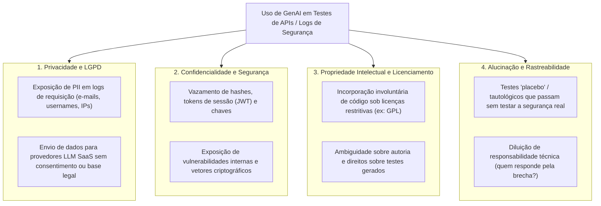
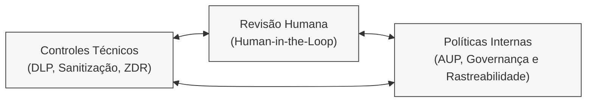

# Unidade IV: Ética, Governança e Riscos no Uso de GenAI em Testes de Software

**Especialização em Inteligência Artificial — Universidade Federal de Goiás (UFG)**  
**Projeto de Referência:** [Secret Store](https://github.com/dmcardoso/secret-store)  
**Autor:** Diego Moreira Cardoso  
**Tema:** Uso ético da IA Generativa em testes de software, privacidade (LGPD), propriedade intelectual e mecanismos de governança.

---

## 1. Contexto Realista Escolhido

**Geração de Casos de Teste de Integração e Massas de Dados Sintéticas a partir de Telemetria, Logs e Contratos de APIs em Sistemas de Gerenciamento de Credenciais (IAM / Vaults de Segredos)**.

### Cenário Operacional
No desenvolvimento de serviços críticos de segurança — como o **Secret Store**, que expõe APIs REST para criação, consulta e atualização de credenciais protegidas por criptografia simétrica (AES-256-CBC) —, equipes de QA e engenharia enfrentam o desafio contínuo de gerar testes de integração abrangentes e reproduzir incidentes de borda. 

Um caso de uso altamente atraente e comum na indústria é utilizar LLMs para:
1. Analisar logs de requisições HTTP e exceções de produção para derivar automaticamente cenários de teste negativos e de regressão.
2. Sintetizar fixtures e massas de teste que simulem padrões complexos de autenticação, mutações de dados e fluxos de exceção.
3. Gerar testes de conformidade de contrato de API a partir de especificações OpenAPI/Swagger.

Embora esse uso aumente expressivamente a produtividade, a interface direta entre ferramentas de GenAI e dados provenientes de sistemas de credenciais introduz dilemas éticos, regulatórios e de segurança severos.

---

## 2. Riscos Éticos e Legais Identificados

### 2.1. Privacidade de Dados e Não Conformidade com a LGPD (Lei nº 13.709/2018)
* **Vazamento Inadvertido de Dados Pessoais (PII):** Logs de tráfego HTTP frequentemente contêm identificadores de usuários (`username`, e-mails, endereços IP de origem, IDs de sessão). Ao copiar ou canalizar logs reais para prompts de LLMs comerciais em nuvem pública, ocorre um tratamento de dados pessoais (coleta, transmissão e processamento por terceiros) sem base legal apropriada (art. 7º da LGPD) e em potencial violação dos princípios da finalidade, necessidade e segurança (art. 6º).
* **Risco de Treinamento Não Autorizado:** Se a organização utiliza planos gratuitos ou padrões de provedores que utilizam entradas de usuários para retreinar modelos futuros, dados pessoais sensíveis ou identificáveis podem ser memorizados e posteriormente reproduzidos para usuários externos via *prompt extraction*.

### 2.2. Confidencialidade e Exposição de Segredo de Negócio
* **Credenciais e Vetores de Cifra em Prompts:** Em APIs de cofres de senhas, a ingestão de payloads ou rastros de erro pode expor inadvertidamente tokens de autenticação, estruturas internas de banco de dados (`PostgreSQL`), parâmetros de vetor de inicialização (IV) ou caminhos de endpoints administrativos confidenciais.
* **Mapeamento de Superfície de Ataque por Terceiros:** A submissão contínua de contratos internos de APIs a nuvens terceirizadas constrói, externamente à empresa, um mapa detalhado da arquitetura e das potenciais vulnerabilidades da infraestrutura.

### 2.3. Propriedade Intelectual, Licenciamento e Contaminação de Código
* **Risco de Violação de Licenças (Copyleft):** LLMs são treinadas em corpora maciços de código aberto. Existe o risco de a IA sugerir blocos de testes complexos, stubs ou utilitários extraídos verbatim de repositórios sob licenças permissivas que exigem atribuição ou, pior, sob licenças copyleft estritas (como GPL ou AGPL), contaminando a base de código proprietária e gerando litígios de propriedade intelectual.

### 2.4. Alucinação, Falsa Sensação de Segurança e Rastreabilidade (Accountability)
* **Testes Tautológicos e Placebos:** LLMs tendem a produzir código que *aparenta* estar correto sintaticamente, mas que semanticamente valida asserções vazias (por exemplo, testar se um status é `200` sem verificar se a credencial foi realmente criptografada no banco). Isso gera uma **falsa sensação de cobertura de testes**, mascarando vulnerabilidades críticas.
* **Diluição de Responsabilidade Técnica:** Quando um teste falha em detectar uma brecha de segurança em produção, a ausência de rastreabilidade sobre a proveniência do teste (se foi desenhado por um engenheiro ou gerado cegamente por IA) dificulta a auditoria e a imputação de responsabilidade profissional.

---

## 3. Mecanismos de Governança, Controles Técnicos e Revisão Humana

Para equilibrar **produtividade acelerada** com **responsabilidade ética e jurídica**, é imprescindível estabelecer uma tríade de mitigação:

### 3.1. Controles Técnicos
1. **Pipeline Automatizado de Sanitização e Mascaramento Pré-Prompt (DLP):**
   * Nenhum dado oriundo de ambientes de produção (logs, dumps ou payloads) deve ser enviado à LLM diretamente.
   * Obrigatoriedade de ferramentas automatizadas de *Data Scrubbing* para substituição de dados pessoais por pseudônimos sintéticos e ofuscação de segredos (hashes, senhas, tokens) antes da formulação de qualquer prompt.
   * **Recomendação:** Prompts devem ser alimentados a partir de **esquemas abstratos** (ex.: especificações OpenAPI, interfaces TypeScript e DTOs) e nunca de registros de produção reais.
2. **Ambiente com Garantia de Retenção Zero de Dados (Zero Data Retention - ZDR):**
   * Utilização exclusiva de contas corporativas (Enterprise Tier) com cláusula contratual explícita de ZDR, garantindo que nenhum dado, prompt ou completion seja utilizado pelo provedor para retreinamento de modelos.
   * Para dados altamente sensíveis, preferência pela execução de modelos open-weights hospedados localmente ou em VPC isolada (on-premises).

### 3.2. Práticas de Revisão Humana (*Human-in-the-Loop*)
1. **Auditoria Rigorosa de Asserções e Comportamento Semântico:**
   * Nenhum teste gerado por IA pode ser integrado à esteira de CI/CD sem revisão manual de um engenheiro.
   * O revisor deve validar a efetividade do teste aplicando técnicas como **Testes de Mutação** (*Mutation Testing*) para assegurar que o teste realmente falharia caso a lógica do sistema quebrasse (evitando testes placebos).
2. **Validação de Invariantes Críticos:**
   * O revisor humano deve garantir que testes de segurança inspecionem o estado real de persistência (como validamos na Unidade III, inspecionando o PostgreSQL para garantir que senhas não estão em texto puro).

### 3.3. Políticas Organizacionais e Governança
1. **Política de Uso Aceitável de IA (AUP — Acceptable Use Policy):**
   * Classificação de dados corporativos em níveis de confidencialidade (*Público*, *Interno*, *Confidencial*, *Restrito*), com proibição explícita de submeter dados Confidenciais ou Restritos a modelos de IA de terceiros sem homologação prévia.
2. **Princípio da Responsabilidade Humana Inalienável (*Accountability*):**
   * A política corporativa deve determinar com clareza: a IA generativa é um instrumento de suporte (copiloto); a **responsabilidade técnica, ética e jurídica** pelo código, pelos testes e pela segurança do software permanece integralmente com o desenvolvedor que submeteu o commit e com o revisor que aprovou a Pull Request.
3. **Rastreabilidade e Proveniência de Código:**
   * Registro explícito nos metadados de commits e PRs indicando quais partes do código ou suítes de teste contaram com assistência de GenAI, permitindo auditorias periódicas e gestão de riscos de propriedade intelectual.

---

## 4. Conclusão

A IA Generativa é um poderoso catalisador para a qualidade de software, mas não pode operar em um vácuo ético ou de governança. Em cenários de alta sensibilidade, a blindagem técnica pré-prompt, o compromisso contratual de privacidade e a primazia da revisão humana garantem que a velocidade trazida pela GenAI não custe a conformidade legal, a privacidade dos usuários ou a integridade da arquitetura de segurança.
